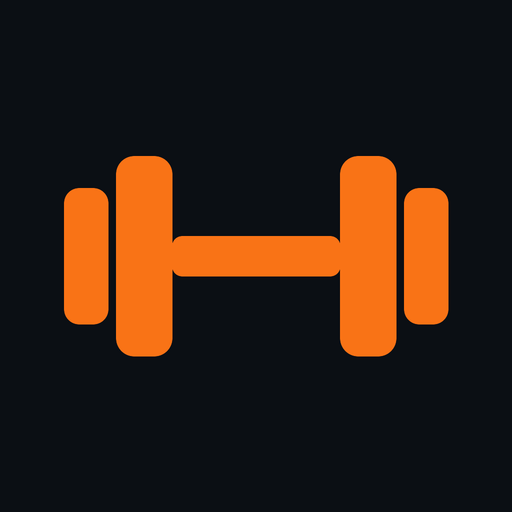
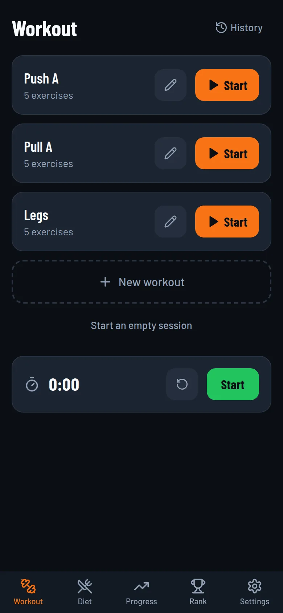
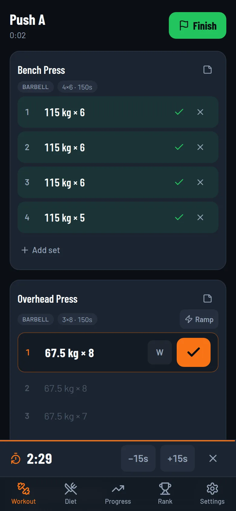
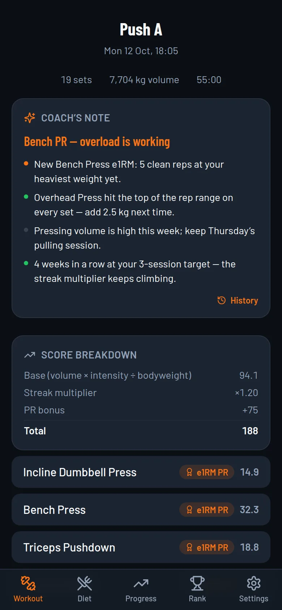
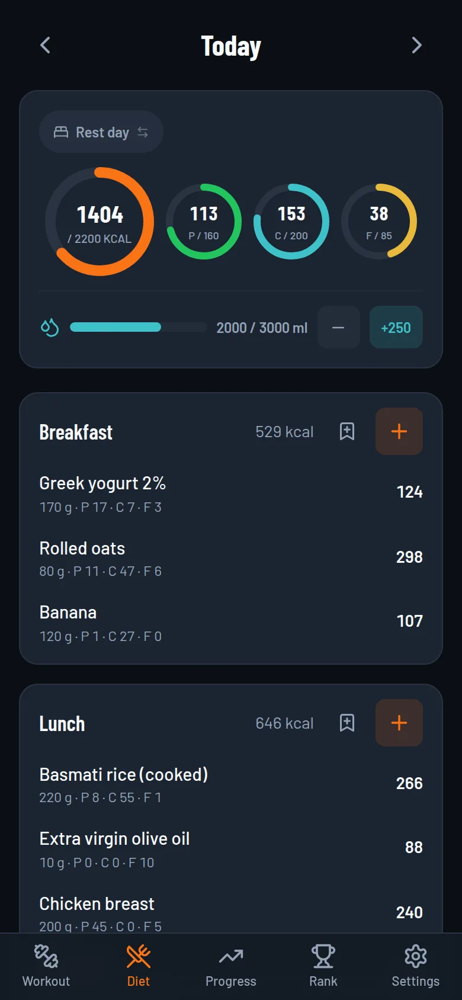
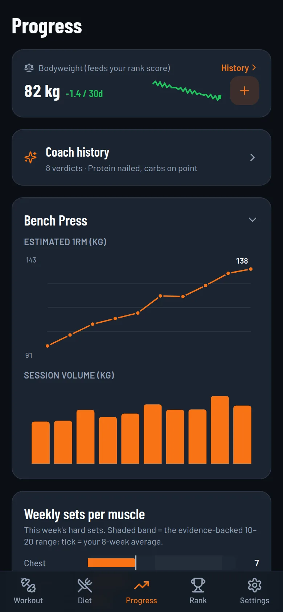
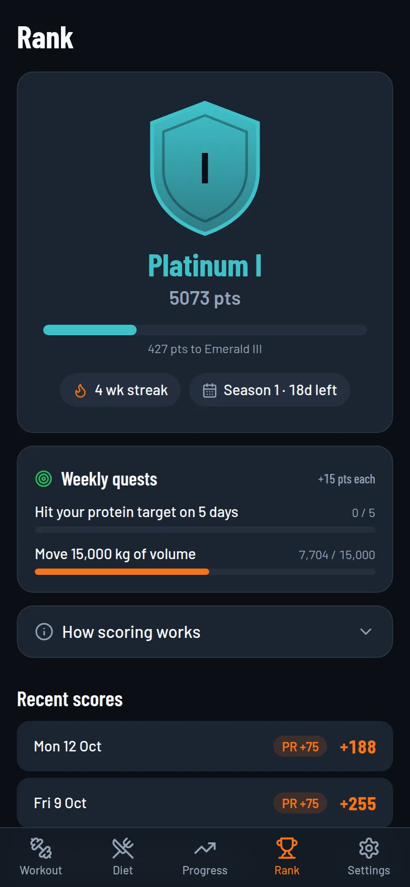
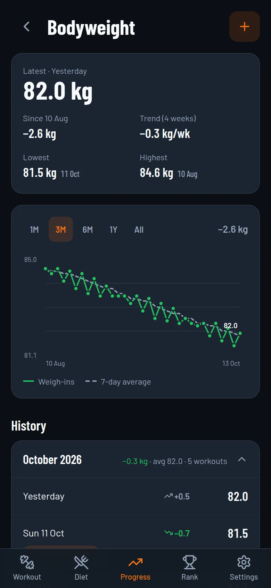
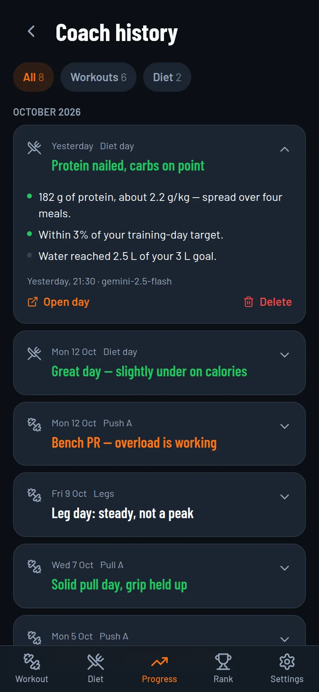
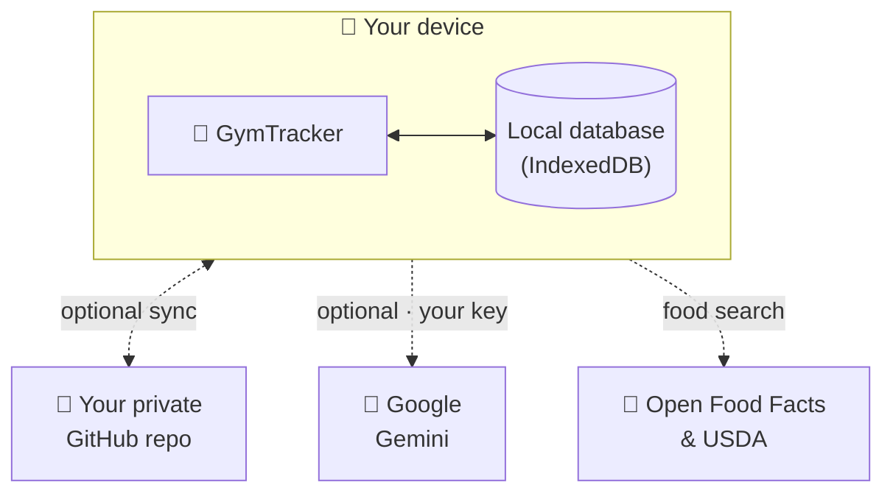

<div align="center">



# GymTracker

**Log your lifts, track your food, climb the ranks.**<br/>
A free, offline-first fitness app with an AI coach, for the web and Android.

<a href="https://monniale.github.io/GymTracker/"></a>
&nbsp;
<a href="ANDROID.md"></a>

[](https://github.com/monniale/GymTracker/actions/workflows/deploy.yml)


[Features](#-features) · [Screenshots](#-screenshots) · [Get started](#-get-started) · [Your data](#-where-your-data-lives) · [Develop](#-develop)

</div>

---

## ✨ Why GymTracker?

- ⚡ **Fast at the gym**: your sets are pre-filled from last time. Tap ✓ and the rest timer starts on its own.
- 📴 **Works offline**: everything is stored on your phone. No account, no sign-up, no server.
- 🏆 **Makes training a game**: ranks from Copper to Champion, 12-week seasons, streaks, quests and achievements.
- 🤖 **Has an AI coach**: bring your own free Gemini key and get a written verdict on every workout and every day of eating.
- 🔄 **Syncs on your terms**: optional sync to *your own* private GitHub repo. No one else's cloud is involved.

## 📸 Screenshots

<div align="center">
<table>
  <tr>
    <td align="center"><br/><sub><b>Your workouts</b></sub></td>
    <td align="center"><br/><sub><b>Live session + rest timer</b></sub></td>
    <td align="center"><br/><sub><b>AI coach's verdict</b></sub></td>
    <td align="center"><br/><sub><b>Diet & macros</b></sub></td>
  </tr>
  <tr>
    <td align="center"><br/><sub><b>Progress charts</b></sub></td>
    <td align="center"><br/><sub><b>Rank & season</b></sub></td>
    <td align="center"><br/><sub><b>Bodyweight history</b></sub></td>
    <td align="center"><br/><sub><b>Coach history</b></sub></td>
  </tr>
</table>
<sub>Screenshots use made-up demo data.</sub>
</div>

## 🚀 Features

### 🏋️ Workouts
- **Templates** with sets, reps, rest times and supersets.
- **One-tap logging**: every set is pre-filled from your last session.
- **Progression suggestions**: the app tells you when to add weight, using double progression.
- **Warm-up ramps** and a **plate calculator** for barbell lifts.
- Equipment variants (barbell, dumbbell, machine, cable…), per-exercise notes, and exercises added mid-session.
- **History calendar**: open any past workout and fix a typo. Its score is recalculated.

### ⏱️ Rest timer
- Starts by itself when you log a set: a short rest after warm-ups, and it waits for the last exercise of a superset.
- Buttons for −15 s, +15 s and skip. It keeps the right time if you leave the app and come back.
- On Android it runs as a **live countdown notification** that rings even if the app is closed (details below).

### 🥗 Nutrition
- A daily log by meal, with **separate macro targets for training and rest days**. The day type is picked automatically.
- **Barcode scanner** plus food search across **Open Food Facts** and **USDA FoodData Central**.
- Custom foods, editable macros (your corrections always win), a recipe builder, saved meals and copy-yesterday.
- A water tracker and a weekly nutrition report.

### 📈 Progress
- Estimated 1RM and volume charts for every exercise.
- **Weekly sets per muscle**, compared with the evidence-based 10–20 hard-sets range.
- A **PR wall** with strength-standard levels from Novice to Elite.
- **Bodyweight history**:
  - a trend chart with a 7-day average;
  - your kg-per-week rate and your lowest and highest weights;
  - a month-by-month timeline with milestones such as *"−3 kg since start"*.

### 🏆 Rank & seasons
- Tiers from **Copper III to Champion**, driven by an evidence-based score:
  - volume relative to bodyweight, weighted by intensity (% of your estimated 1RM);
  - **PR bonuses**, a **weekly streak multiplier**, and caps on junk volume.
- **12-week seasons** with a recap and a "ghost race" against your previous season.
- Weekly quests, achievements and PR confetti 🎉

### 🤖 AI coach (Gemini, optional)
- A **coach's note after every workout** and a **diet report** for any day.
- **Suggested opening weights** before a session, ideas to **complete your macros**, and **food swaps**.
- **Fallback to other models**: if your model runs out of free quota or is down, the request is retried on your key's other free Flash models.
- **Coach history**: every verdict is saved and synced, including the earlier one when you regenerate a note.

> [!NOTE]
> The AI coach uses **your own free Gemini API key** from [Google AI Studio](https://aistudio.google.com/apikey). The key stays on your device and is never synced. Only the workout and diet numbers needed for a note are sent to Google.

### 📱 Android app extras
The same app, packaged for Android with [Capacitor](https://capacitorjs.com). It is tuned for a Samsung Galaxy S25 on One UI 8.5 / Android 16 and runs on Android 7 and later.

- ⏲️ **Live rest countdown**: a countdown in the notification shade (Live Updates on Android 16), with **Skip** and **+15 s** buttons. It rings even if the app was closed.
- 🔔 **Smart reminders**: training days, meals, water, rank decay and streak warnings, a weekly recap, and weigh-ins. Each one can be switched on or off.
- 📷 **Native barcode scanner**: Google ML Kit, with the camera scanner as a fallback.
- 🤏 **Feels native**: haptics, back-button navigation, the screen stays on during a workout, and backups export through the share sheet.

See **[ANDROID.md](ANDROID.md)** for how to build and install it.

## 🏁 Get started

### 🌐 Use it in your browser
Open **https://monniale.github.io/GymTracker/**. That's it. It works offline after the first visit.

### 📲 Install it like an app

<details>
<summary><b>iPhone (Safari)</b></summary>

1. Open the link above in **Safari**.
2. Tap **Share → Add to Home Screen**.
3. Launch it from the icon. It opens full-screen and works offline.

On iOS, sounds only play while the app is on screen, which is why it keeps the screen awake during a workout. Export a backup now and then: deleting the icon also deletes its data.
</details>

<details>
<summary><b>Android (Chrome)</b></summary>

Open the link in **Chrome**, then **⋮ → Install app**. For the full Android app with notifications, see [ANDROID.md](ANDROID.md).
</details>

### 🤖 Turn on the AI coach (optional)
1. Create a free API key at [Google AI Studio](https://aistudio.google.com/apikey).
2. In the app, go to **Settings → AI Coach** and paste it.
3. Finish a workout and your coach's note appears.

### 🔄 Sync between devices (optional)
**Settings → Sync**: connect a **private GitHub repo** with a fine-grained token, and your data syncs between your phone and your browser.

## 🔒 Where your data lives



- **The main copy is always on your device.** The app has no server of its own and no account.
- **GitHub Sync** pushes a snapshot of your data to a repo *you* own. It's also your backup.
- **Your keys never leave the device**: the Gemini key and the GitHub token are never synced or exported.
- You can also **export or import a JSON backup** at any time from Settings.

> [!TIP]
> Moving to a new phone? Connect GitHub Sync there and choose **"Use cloud data"**, or import your JSON backup *before* logging anything new.

## 🛠️ Develop

**Tech stack:** React 18 · TypeScript · Vite 5 · Tailwind CSS 3 · Dexie (IndexedDB) · Zustand · Vitest · vite-plugin-pwa · zxing-wasm · Capacitor 8

```bash
npm install
npm run dev        # dev server with hot reload
npm test           # unit tests (Vitest)
npm run build      # type-check + production build → dist/
npm run preview    # serve the production build locally
```

The web app needs **Node 18+**. The Android build needs **Node 22+** and **JDK 21**; see [ANDROID.md](ANDROID.md).

<details>
<summary><b>📂 Project layout</b></summary>

```
src/
├── screens/      # workout · diet · progress · rank · settings
├── components/   # shared UI: charts, sheets, steppers, AI cards…
├── lib/          # scoring, sync, Gemini client, nutrition, reminders…
├── db/           # Dexie schema, seed data, backup / import
└── native/       # Android-only code (never shipped in the web build)
android/          # Capacitor Android project (Java plugins)
scripts/          # PWA build checks, Android build / release / smoke tests
```

New here? **[ROUTEMAP.md](ROUTEMAP.md)** maps every module and the rules the code relies on, such as the sync allow-list and the native/web split.
</details>

<details>
<summary><b>🚢 Deploy your own copy (GitHub Pages)</b></summary>

1. Fork this repo, or push it to a repo named **GymTracker**. The name must match `base` in `vite.config.ts`; change it there if you use another name.
2. In the repo: **Settings → Pages → Source: GitHub Actions**.
3. Push to `main`. The included workflow (`.github/workflows/deploy.yml`) builds and deploys automatically.

Without CI: run `npm run deploy` (uses the `gh-pages` branch), or build with `BASE_PATH=/ npm run build` and drag `dist/` onto [Netlify Drop](https://app.netlify.com/drop).
</details>

## 🙏 Credits

- Food data from **[Open Food Facts](https://world.openfoodfacts.org)** and **[USDA FoodData Central](https://fdc.nal.usda.gov)**
- AI by **[Google Gemini](https://ai.google.dev)**
- Icons by **[Lucide](https://lucide.dev)** · barcode reading by **[zxing-wasm](https://github.com/Sec-ant/zxing-wasm)** and **Google ML Kit**

<div align="center">
<br/>
<sub>Built with 🧡 for lifting heavy things and eating enough protein.</sub>
</div>
